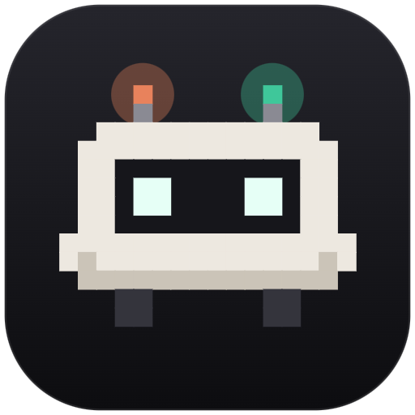
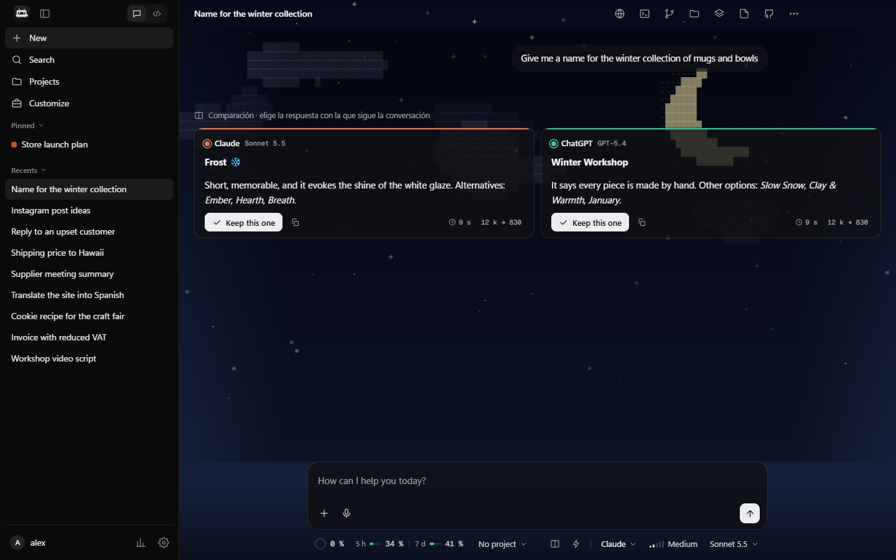
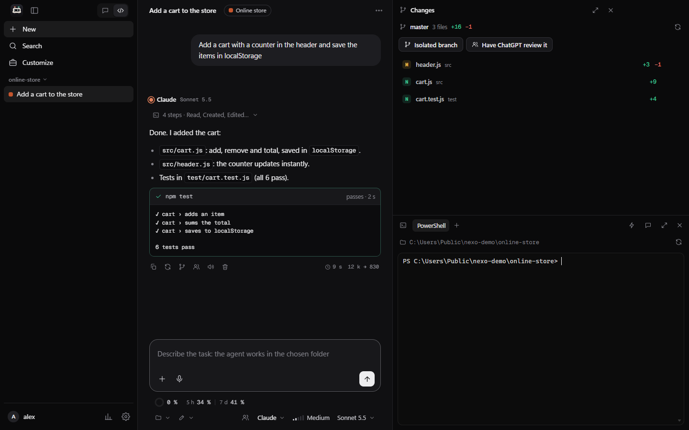

<div align="center">

<a href="https://github.com/CrushedDEV/nexo-releases"></a>

<br>

[](https://x.com/crusheed_)
[](https://github.com/CrushedDEV/nexo-releases/releases/latest)
[](https://dropmixr.es)
[](https://beout.es)

</div>

<br>

##  Featured: Nexo

<table>
<tr>
<td width="62%" valign="top">

**Claude and ChatGPT in one desktop app.** Your subscriptions and API accounts share memory,
projects and conversations, so you can switch AI mid-conversation without losing context.

- 🤝 **Two AIs, one brain**: compare answers side by side or ask the other AI for a second opinion
- 🤖 **Agents that work on their own**: loop mode and a parallel task board on isolated git branches
- 💳 **Your plans, not credit**: runs on Claude Pro/Max and ChatGPT Plus/Pro through the official CLIs
- 🎨 **Made with care**: animated chat themes, split view, voice mode and a pixel mascot named Nexi

[](https://github.com/CrushedDEV/nexo-releases/releases/latest)
[](https://github.com/CrushedDEV/nexo-releases/releases)


**[⬇ Download for Windows](https://github.com/CrushedDEV/nexo-releases/releases/latest)** · [See it in action](https://github.com/CrushedDEV/nexo-releases#-features)

</td>
<td width="38%" valign="top">

<a href="https://github.com/CrushedDEV/nexo-releases"></a>
<a href="https://github.com/CrushedDEV/nexo-releases"></a>

</td>
</tr>
</table>

<br>

## 🧩 More projects

<table>
<tr>
<td width="50%"><a href="https://github.com/CrushedDEV/Beatfinder"></a></td>
<td width="50%"><a href="https://dropmixr.es"></a></td>
</tr>
<tr>
<td width="50%"><a href="https://beout.es"></a></td>
<td width="50%"><a href="https://github.com/CrushedDEV/Crusheed-Toolkit"></a></td>
</tr>
</table>

<br>

## ⚡ Tech stack

<p align="center">
  <br>
  
</p>

<br>

## 🧑‍💻 About me

```ts
const oihan = {
  basedIn: "Spain 🇪🇸",
  building: ["Nexo", "DropMixr"],
  focus: ["AI tools", "web platforms", "desktop apps"],
  learning: "game development with Unity",
  offline: "music & DJing 🎧",
  askMeAbout: ["Claude & ChatGPT workflows", "Laravel", "audio analysis"],
};
```

<br>

<div align="center">
<br>
<sub>Thanks for stopping by. If Nexo saves you time, a ⭐ on <a href="https://github.com/CrushedDEV/nexo-releases">nexo-releases</a> helps a lot.</sub>
</div>
