<div align="center">



<br>

[](https://x.com/crusheed_)
[](https://dropmixr.es)
[](https://beout.es)

</div>

<br>

## 🧩 Projects

<table>
<tr>
<td width="50%"><a href="https://github.com/CrushedDEV/Beatfinder"></a></td>
<td width="50%"><a href="https://dropmixr.es"></a></td>
</tr>
<tr>
<td width="50%"><a href="https://github.com/CrushedDEV/nexo-releases"></a></td>
<td width="50%"><a href="https://beout.es"></a></td>
</tr>
<tr>
<td width="50%"><a href="https://github.com/CrushedDEV/Crusheed-Toolkit"></a></td>
<td width="50%"><a href="https://github.com/CrushedDEV/Paypal-Integration-in-Laravel"></a></td>
</tr>
</table>

<br>

## ⚡ Tech stack

<p align="center">
  <br>
  
</p>

<br>

## 🧑‍💻 About me

```ts
const oihan = {
  basedIn: "Spain 🇪🇸",
  building: ["web platforms", "AI tools", "desktop apps"],
  currentProjects: ["DropMixr", "Nexo", "BeOut"],
  learning: "game development with Unity",
  offline: "music & DJing 🎧",
  askMeAbout: ["Laravel", "React & Astro", "audio analysis", "AI workflows"],
};
```

<br>

<div align="center">
<sub>Thanks for stopping by 👋</sub>
</div>
